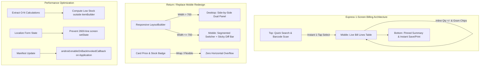

# Implementation Plan: Billing UI Redesign, Return/Replace Overflow Fix & Performance Optimization

## 1. Executive Summary & Root Cause Analysis

This document provides a comprehensive implementation plan to resolve layout errors, eliminate frame drops (UI jank), address Android system warnings, and transition the mobile billing experience to an **Express 1-Screen Counter Billing** workflow.

---

### 1.1. Issue 1: RenderFlex Overflow in Return/Replace Module
* **Diagnostic**:
  ```text
  A RenderFlex overflowed by 71 pixels on the right.
  Row: lib/features/returns/return_replace_screen.dart:2128:37
  Additional exceptions: RenderFlex overflowed by 27 pixels and 73 pixels on the right.
  ```
* **Root Cause**:
  In [`return_replace_screen.dart:2003-2026`](file:///F:/Bharat_Provision/Bharat_Provision/lib/features/returns/return_replace_screen.dart#L2003-L2026), `_buildReplaceModeBody()` hardcodes a horizontal `Row` containing both the **Catalog Panel** (`flex: 5`) and the **Cart Panel** (`flex: 6`), even when running on mobile devices (`maxWidth <= 700`).
  On typical Android devices (~380–410dp screen width), the Catalog panel is restricted to ~160dp width. Inside that restricted column, the item card row:
  ```dart
  Row(
    children: [
      Text('₹${p.sellPrice.toStringAsFixed(2)} / $u'),
      const SizedBox(width: 8),
      Container(child: Text('સ્ટોક: ...')),
    ],
  )
  ```
  exceeds the ~106dp available layout constraint, triggering repeated horizontal overflows (71px, 27px, 73px) and making both panels cramped and difficult to touch.

---

### 1.2. Issue 2: Inefficient Mobile Billing Workflow (Frequent Tab Switching)
* **Problem**:
  In [`billing_home_screen.dart:487-539`](file:///F:/Bharat_Provision/Bharat_Provision/lib/features/billing/billing_home_screen.dart#L487-L539), the mobile layout forces a two-tab view:
  * Tab 0: "ઉત્પાદનો" (Products catalog)
  * Tab 1: "કાર્ટ" (Cart & Bill summary)
* **Impact**:
  To add an item, the shopkeeper must navigate to "ઉત્પાદનો", search, tap to add, and then switch to "કાર્ટ" to verify totals, adjust quantities, or delete lines. To add another item, they must switch back to "ઉત્પાદનો". For a bill with 8–10 items, this requires 16–20 tab transitions, causing friction during peak counter hours.

---

### 1.3. Issue 3: UI Frame Skips & Choreographer Warnings
* **Diagnostic**:
  ```text
  I/Choreographer: Skipped 291 frames! Application doing too much work on its main thread.
  I/Choreographer: Skipped 128 frames!
  I/Choreographer: Skipped 34 frames!
  ```
* **Root Causes**:
  1. **Heavy In-Builder Filtering**: In [`billing_product_panel.dart:467-474`](file:///F:/Bharat_Provision/Bharat_Provision/lib/features/billing/views/billing_product_panel.dart#L467-L474), `displayItems.where((p) => p.stockQty > 0 && p.isLowStock).toList()` executes inside `ListView.builder`'s `itemBuilder` on **every single frame/item scrolled or rebuilt**, consuming main thread CPU cycles.
  2. **Soft Keyboard Viewport Re-layouts**: Opening the soft keyboard generates 20+ viewport metric events. Because `IndexedStack` keeps both product and cart trees active, both massive widget trees undergo synchronized re-layout.
  3. **Keystroke `setState` across 2,600 Lines**: In [`return_replace_screen.dart:101-108`](file:///F:/Bharat_Provision/Bharat_Provision/lib/features/returns/return_replace_screen.dart#L101-L108), text controllers trigger `setState` on the top-level screen widget upon every character input.
  4. **Debug Mode Overhead**: In `debug` mode, JIT compilation, devtools observatory checks, and unoptimized shaders contribute to initial startup frame drops (291 frames) during Vulkan-to-OpenGLES fallback on Android devices.

---

### 1.4. Issue 4: Android Manifest Warning
* **Diagnostic**:
  ```text
  W/OnBackInvokedCallback: OnBackInvokedCallback is not enabled for the application.
  Set 'android:enableOnBackInvokedCallback="true"' in the application manifest.
  ```
* **Root Cause**:
  `android:enableOnBackInvokedCallback="true"` is declared on the `<activity>` element in [`AndroidManifest.xml`](file:///F:/Bharat_Provision/Bharat_Provision/android/app/src/main/AndroidManifest.xml#L34), but Android 13+ (API 33+) requires it directly on the parent `<application>` tag.

---

## 2. Proposed Architectural Architecture & Solutions



---

## 3. Step-by-Step Implementation Roadmap

### Step 1: Android Manifest & Build Configuration Fixes
* **File**: [`android/app/src/main/AndroidManifest.xml`](file:///F:/Bharat_Provision/Bharat_Provision/android/app/src/main/AndroidManifest.xml)
* **Changes**:
  1. Add `android:enableOnBackInvokedCallback="true"` to the `<application>` tag (Line 18).
  2. Keep existing activity configurations intact.
* **File**: [`android/app/build.gradle.kts`](file:///F:/Bharat_Provision/Bharat_Provision/android/app/build.gradle.kts)
* **Changes**:
  1. Ensure JavaCompile options include `-Xlint:-options` to cleanly suppress obsolete source/target 8 warnings emitted by legacy third-party plugins.

---

### Step 2: Return/Replace Module UI Overflows & Mobile Optimization
* **File**: [`lib/features/returns/return_replace_screen.dart`](file:///F:/Bharat_Provision/Bharat_Provision/lib/features/returns/return_replace_screen.dart)
* **Changes**:
  1. **Mobile Layout for Replace Mode**:
     * Update `_buildReplaceModeBody()`:
       * When `maxWidth > 700`: Maintain wide-screen split view (`Row` with `Catalog` and `Cart`).
       * When `maxWidth <= 700`: Render a mobile-first segmented view:
         * **Section A**: "૧. ઉત્પાદનો પસંદ કરો (Catalog)" (full screen search and product list).
         * **Section B**: "૨. બદલી બિલ (Cart & Summary)" (full screen cart with price difference and payment confirmation).
       * Implement a **Sticky Bottom Difference Bar** visible across both views, showing:
         `બદલી કુલ: ₹X.XX | તફાવત: ₹Y.YY` with a quick "કાર્ટ જુઓ (View Cart)" button.
  2. **Product Item Overflow Fix**:
     * In `_buildReplaceCatalogPanel()` (Lines 2128–2172), replace the fixed-width `Row` with a responsive `Wrap` or flexible column:
       * Wrap the price and stock badge in a `Wrap(spacing: 8, runSpacing: 4, children: [...])`.
       * Apply `maxLines: 1` and `overflow: TextOverflow.ellipsis` to text widgets so it automatically adjusts to any screen width.

---

### Step 3: Performance Optimization to Eliminate Frame Drops
* **Files**:
  * [`lib/features/billing/views/billing_product_panel.dart`](file:///F:/Bharat_Provision/Bharat_Provision/lib/features/billing/views/billing_product_panel.dart)
  * [`lib/features/returns/return_replace_screen.dart`](file:///F:/Bharat_Provision/Bharat_Provision/lib/features/returns/return_replace_screen.dart)
* **Changes**:
  1. **Remove O(N) filtering from `itemBuilder`**:
     * Move `final lowStockItems = displayItems.where(...).toList()` out of `ListView.builder.itemBuilder`.
     * Perform this check once when `displayItems` data changes or via an asynchronous post-frame callback.
  2. **Debounce & Localize Keystroke Updates**:
     * In `return_replace_screen.dart`, prevent text controller listeners from calling root-level `setState(() {})` during every keystroke. Use localized builders or `FocusNode` listeners for input validation.
  3. **Repaint Boundary & Layout Stability**:
     * Wrap fast-updating panels with `RepaintBoundary` so that cursor blinking and scrolling do not cause neighboring layout repaints.

---

### Step 4: Express 1-Screen Billing UI Implementation
* **Files**:
  * [`lib/features/billing/billing_home_screen.dart`](file:///F:/Bharat_Provision/Bharat_Provision/lib/features/billing/billing_home_screen.dart)
  * [`lib/features/billing/views/bill_lines_panel.dart`](file:///F:/Bharat_Provision/Bharat_Provision/lib/features/billing/views/bill_lines_panel.dart)
* **Design Specifications**:
  1. **Unified Top Bar (Fast Search & Customer)**:
     * Compact customer selection chip (defaulting to Cash / General Customer).
     * High-speed autocomplete search field that accepts Gujarati name, English name, or barcode.
     * Tapping a product instantly appends it to the active bill table without switching tabs or screens.
  2. **Central Area (Live Bill Lines Table)**:
     * Occupies the main screen viewport.
     * Shows current lines in real-time with:
       * Item name (Gujarati).
       * Unit price.
       * Inline quantity adjustment (`-` / `+` buttons and quick weight presets for Kirana items: `100g`, `250g`, `500g`, `1kg`).
       * Line total and instant delete button.
  3. **Pinned Bottom Bar (Summary & Print)**:
     * Fixed at the bottom of the screen:
       * Total Items Count.
       * Bill Grand Total (`₹`).
       * Primary action buttons: "સાચવો અને છાપો (Save & Print)" and "સાચવો (Save)".
     * Total tab switches required: **0**.

---

## 4. Verification & Testing Matrix

| Test Case | Scenario | Expected Outcome |
| :--- | :--- | :--- |
| **TC-01** | Open Return/Replace screen on mobile Android device. | Replace mode fits the screen cleanly. No `RenderFlex overflowed by X pixels` errors. |
| **TC-02** | Add items in Replace Mode on mobile. | User can toggle between Catalog and Cart smoothly with live price diff bar pinned. |
| **TC-03** | Test Express 1-Screen Billing on mobile. | Products are searched and added directly to the active bill without leaving the screen or switching tabs. |
| **TC-04** | Rapid typing in search and inputs. | No frame drops (`Skipped frames`) during typing; responsive 60fps interaction. |
| **TC-05** | Android Log Inspection. | No `OnBackInvokedCallback is not enabled for the application` warning in logcat. |
